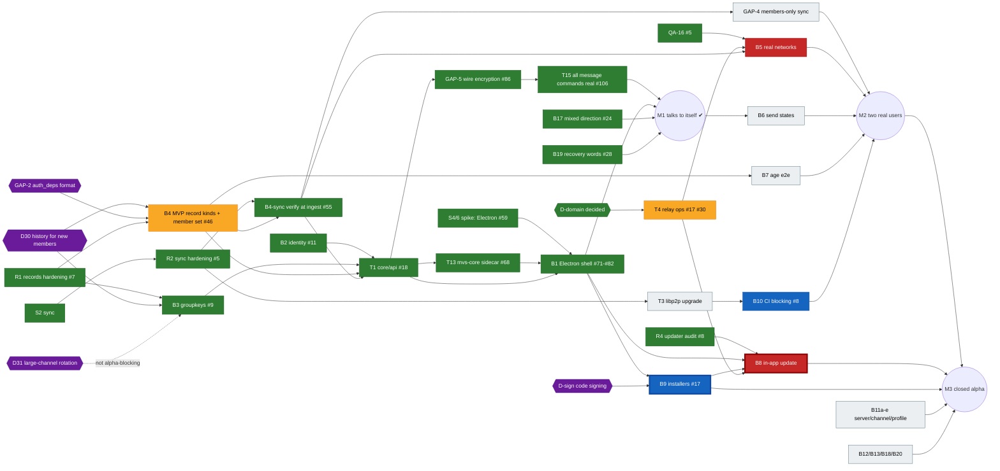

# MVS task board

The single source of truth for who does what, in which order, and what blocks the closed alpha.
Owner: pm (see [`docs/TEAM.md`](TEAM.md)). Updated whenever a PR lands; if this board disagrees with a PR, a review or a chat, **the board wins until it is corrected here**.

Last updated: 2026-11-25, pm batch. **0.5.0 is being tagged.** Since the 2026-11-18 batch: G-05, G-06, G-41, G-14, G-92, G-78 (#513), B7-k (#544, #551), B20, the unreadable-message placeholders (#527, #558), the P1 lost message, #560 (clippy) and #562 (`memberSearch`) are done; G-77 and G-51 have their core. **New epic: relay-in-app (#561)**, see "Device link, member relays, relays".

**Contents:** [Rules](#rules) · [Milestones](#milestones) · [Open PRs](#open-prs) · [Board](#board) · [Dependency map and critical path](#dependency-map-and-critical-path) · [Next assignments](#next-assignments) · [File ownership](#file-ownership) · [Risks and blockers](#risks-and-blockers) · [Owner decisions](#owner-decisions)

---

## Rules

- **Owner column** uses the handles in [`docs/TEAM.md`](TEAM.md) (e.g. `tech-lead`, `dev-sync`, `product-lead`). `core-5` is an open core-developer slot.
- **Status:** `todo` · `in progress` · `in review` (PR open, waiting for a verdict) · `blocked` (named blocker) · `done` (merged to `main`).
- **Size:** S ≤ 1 PR of a day, M = 1–2 PRs, L = several PRs or a new crate.
- **Milestones:** M1, M2, M3 (below). `–` means after the closed alpha.
- **IDs** are the ones the source documents use, so they can be grepped: `B*` backlog (`docs/reviews/po-review-1.md`), `UX-*` (`docs/reviews/ux-review-1.md`), `QA-*` (`qa/BUGS.md`, PR #13), `U*` PO screenshot bugs, `ש-*` PO spec questions, `GAP-*` threat model (`docs/security/threat-model.md`, PR #15), `D*` owner decisions (spec decision log), `R*` review findings and `S*` spikes (this board), `T*` items that only exist here.
- **Review flow** ([TEAM.md](TEAM.md#review-flows)): engineering PRs need tech-lead (+ sec-lead for crypto, identity, permissions, network) → manager merges. A lead's own PR is reviewed by another lead.
- **Product review gate:** product, UX, business, QA-plan and board PRs need a `VERDICT: APPROVE` from product-lead. product-lead's own PRs are reviewed by ux (plus another lead). Engineering features are accepted or rejected by product-lead against their acceptance criteria before they are marked `done`.
- **Acceptance criteria:** B-items in `docs/reviews/po-review-1.md` §8; T-items in [T acceptance criteria](#t-acceptance-criteria) below.
- **Every UI PR:** AA contrast (G-112, B20) and reduced motion (G-114, B21) are a condition of acceptance (product-lead, #320).
- **Language:** Management text (docs, PRs, notes, board) is English only; the app UI ships Hebrew and English (owner, 2026-11-11).
- **CI checks:** `main` has a ruleset with 6 required checks (owner). **Never rename a CI job**, or every open PR blocks on a check that no longer reports.
- Before starting an item, check [File ownership](#file-ownership). One writer per path at a time.
- Never commit IPs, keys, `.env` files or real tester data.

## Milestones

| | Name | Done when |
| --- | --- | --- |
| **M1** | Talks to itself | One desktop build runs the real Rust core behind the UI (no mock): create an identity from 12 words, create a server, post encrypted messages, restart and see them again. Two instances on one machine sync. **`mvs-core` answers every message command for real** (send, get, count, edit, delete, retry; none `not-implemented`) (T15 criterion, product-lead; #89 unlocks the cipher at identity load, create and restore). Proof: chat against the real core in the Electron build (dev-ui). **Status: done** (#107, #125 merged; product-lead accepted). |
| **M2** | Two real users chat | Two people on different machines and networks (incl. one behind NAT/CGNAT, via relay) join by link, chat with real send states, kick works and re-keys, offline catch-up works. B5 success criteria measured and committed. Threat-model P0 gaps closed. |
| **M3** | Closed alpha release | Installers for Windows, macOS, Linux from CI (signed or documented-unsigned); in-app P2P update with rollback; relay + seeder running behind the owner's domain; P0 bugs closed; testers have instructions. |

## Open PRs

| PR | What | Author | Required verdicts | Status | Next step |
| --- | --- | --- | --- | --- | --- |
| [#465](https://github.com/moranmoa/MVS/pull/465) | docs: CHANGELOG 0.4.7 (replaces the unpublished 0.4.6) | pm / product-lead | product-lead | in review | merge, then the 0.4.7 go/no-go |
| [#466](https://github.com/moranmoa/MVS/pull/466) | docs: G-78 optional app lock design note | dev-voice-shell | tech-lead, sec-lead | in review | tech-lead APPROVE with one change; awaiting sec-lead |
| [#463](https://github.com/moranmoa/MVS/pull/463) | ui: emoji reactions UI (G-26) | dev-ui | tech-lead, product-lead (+ ux visual) | in review | core is merged (#454) |
| [#461](https://github.com/moranmoa/MVS/pull/461) | identity: G-91 phase B, buddies | dev-identity | tech-lead, sec-lead | in review | sync side "BUDDIES on" by dev-sync only after multi-relay part B |
| [#460](https://github.com/moranmoa/MVS/pull/460) | sync: LAN beacon (relay-down part 2, RD2) | dev-sync | tech-lead, sec-lead | in review | changes requested |
| [#459](https://github.com/moranmoa/MVS/pull/459) | relay: `PEER_RELAYS` (multi-relay part C, relay side) | devops | tech-lead, sec-lead | in review | live relay only from `main` with the manager OK |
| [#458](https://github.com/moranmoa/MVS/pull/458) | ui: G-91 restore screen | dev-ui | tech-lead, product-lead (+ ux visual) | in review | – |
| [#447](https://github.com/moranmoa/MVS/pull/447) | ui: "is typing…" on the mock (G-29) | dev-ui | tech-lead, product-lead (+ ux visual) | in review | core by dev-updater (`g29-typing-design.md`) |
| [#433](https://github.com/moranmoa/MVS/pull/433) | voice: TURN path behind a flag (G-81) | voice-d | tech-lead, sec-lead (network) | in review | owner decision on running TURN pending |
| [#220](https://github.com/moranmoa/MVS/pull/220) | infra: relay on a Linux host with host networking (real source IPs for DCUtR) | devops | tech-lead, sec-lead | in review | waits for the owner (relay move); live relay only from `main` |
| [#269](https://github.com/moranmoa/MVS/pull/269) | desktop: document and test the relay's QUIC bootstrap address (#243 follow-up) | dev-voice-shell | tech-lead | in review | goes with #220 |
| [#184](https://github.com/moranmoa/MVS/pull/184) | sync: DCUtR hole punching (design note) | dev-sync | tech-lead, sec-lead | draft | **stale**: DCUtR shipped in #219, QUIC in #243; close |
| [#202](https://github.com/moranmoa/MVS/pull/202) | sync tests: live delivery over a direct link (v0.2.3 regression check) | dev-sync | tech-lead | in review | **stale**: the fix (#206) is merged; merge as a test or close |
| [#101](https://github.com/moranmoa/MVS/pull/101) | B8 design note | dev-updater | tech-lead, sec-lead | in review | **stale**: B8 is built and shipped; merge as history or close |
| [#69](https://github.com/moranmoa/MVS/pull/69) | T12 install/uninstall tests | devops | tech-lead, product-lead | draft | Windows script bug; still wanted for M3 |
| [#354](https://github.com/moranmoa/MVS/pull/354) | docs: design, profile picture and colour for other members | dev-identity | tech-lead | in review | **stale**: built in #359 and #362; merge as history or close |
| #397, #396, #227, #137, #133 | Dependabot: base64 0.23, sha2 0.11, chacha20poly1305 0.11, rand_chacha 0.10, hkdf 0.13 (core) | dependabot | tech-lead, sec-lead | held | crypto crates wait for the libp2p 0.57 bump (T3b); no duplicate crypto crates |
| #47, #45, #43, #41, #40, #38 | Dependabot: vitest 5, plugin-react 6, @types/node 26, actions group, typescript 7, vite 8 (ui) | dependabot | tech-lead | held | one at a time; never rename CI jobs |

**Merged since refresh 11 (#203–#422)**, by release line:

- **0.2.4–0.2.5** (#203–#219): `RUST_LOG` tracing (#204), relayed connection kept (#206, the v0.2.3 regression fix), connection icon (#205, #209), server settings + context menus (#208, #213, #235), invites api + UI (#214, #216), join retry (#215), **in-app update chain** (#211 B8-5, #178, #212), member-gated DCUtR (#219).
- **0.3.0–0.3.3** (#221–#319): **voice v1** (#223, #224, #228, #231, #238, #239, #240, #262; QA #232, #276–#279), QUIC (#243), libp2p 0.56 (#256, T3), **short invite links** (#234, #247, #249, #255, #263), server rename/leave/delete (#251, #261, #264), relay-only (#272–#275), B14 perf harness (#248), Windows static CRT (#282), held messages (#285, #288, #289), restore flow + backup keys (#290–#293, #317), profile editing (#295, #296), join pull fixes (#310, #315), sign out (#304, #305), age 30-day rule (#306, #312), release scripts (#284, #309), T22 notices (#258).
- **0.4.0** (#322–#343): server order (#322), channel order (#323, #325), unread divider (#327, #329), @mentions (#330, #331, #338), mute + mark read (#335), desktop notifications (#336), TURN in the engine (#337), backup store (#339, #340), T23 (#318, #328).
- **0.4.1–0.4.5** (#346–#385): English-only notes (#346, #347), language picker (#348), unread fixes (#351, #352), repo rename (#353), own title bar (#358), profile pictures and colours (#359, #361, #362), voice rooms v2 (#369, #371, #375), relay backup mailbox (#367), T24 pacing (#366), close-hang fix (#373), hourly update checks (#377), profile save (#381, #384), relay-only follow-up (#383).
- **0.4.6 line** (#386–#422): member relays slices 1, 2a, 2b, 3a, 3b (#387, #389, #395, #399, #400, #403, #405), **device link** (#391, #393, #394, #398, #406, #407, #408, #411, #415), keychain fixes (#388, #392), multi-relay part A (#409, #410), relay-2 interim (#404), vendored hickory 0.26 (#412), peer DNS names dropped (#416), flake fixes (#413, #417), gossipsub RUSTSEC fix (#421), notice label sanitising (#422), member-recovery design (#401), QA (#390, #402, #414, #418), CHANGELOG 0.4.6 (#420).

**Merge order**: #465 any time; #458 and #463 after review; #460 after the changes; #459 and #433 on their own. #220 and #269 together when the owner moves the relay. **Dependabot:** crypto crates wait for T3b; ui bumps one at a time. Never rename CI jobs.

---

## Board

### Foundations (core crates)

| ID | Title | Owner | Status | PR | Depends on | Size | MS |
| --- | --- | --- | --- | --- | --- | --- | --- |
| S1 | Signed update chain (`core/updater`) | dev-updater | done | #1 | – | M | M3 |
| S2 | Log sync spike (`core/sync`) | dev-sync | done | #2 | – | M | M1 |
| S3 | Signed records + incremental authority | tech-lead | done | #3 | – | M | M1 |
| R1 | Records/authority hardening: genesis binding, pending-queue flood, `mvs/` contexts | tech-lead | done | #7 | S3 | M | M1 |
| R2 | Sync hardening: canonical deps, bounded input, global pull limit | dev-sync | done | #5 | S2 | M | M1 |
| B2 | Identity: 12 words, keychain, restore (+ QA-01 core side) | dev-identity | done | #11 | – | S | M1 |
| B2-f | B2 follow-up from the approved B19 spec: `getRecoveryChallenge()`; `checkRecoveryWords` returns `{ ok }` or `{ ok: false, wrong }`, only for the challenge positions, capped at 5 failures | dev-identity | done | #77 | #11 ✔, B19 spec ✔ (#22); sec-lead reviews the implementation | S | M1 |
| B3 | Group encryption by epoch, re-key on kick | dev-crypto | done | #9 | S3; D30 for final shape | L | M1 |
| R4 | Updater audit: root-rotation chain DoS, QA-14, QA-15 | dev-updater | done | #8 | S1 | S | M3 |
| QA-16 | `spike-peer` hangs when relay is unreachable | dev-sync | done | #5 | – | S | M2 |
| QA-20 | **Medium** (product-lead): on Linux without an OS keyring (Secret Service) the app cannot start; `mvs-core` only said "Internal" | dev-identity (core error code), dev-ui + dev-voice-shell (T8-01 message), qa (list the keyring as a prerequisite in the testing docs) | in progress (core error #194, T8-01 #191–#193, keychain #388 #392 merged; qa adds the keyring as a testing-docs prerequisite) | #194 #388 #392 | – | S | M3 |
| QF-1 | `channels.spec` fails ~10% under parallel load (3 tests, "element not found"). Theory, not proven: `ChannelDialog` fills its value in a `useEffect` after the first paint | qa (investigate) → dev-ui | open | – | – | S | – |
| R-P0 | **v0.2.3 delivery regression (~5 s)**: env-gated `RUST_LOG` tracing subscriber in the `mvs-core` bin (dev-identity); keep the relayed connection open when a direct one comes up + api `two_peers` latency test < 1 s (dev-sync, #202); smoke with `RUST_LOG`, then **v0.2.4** (devops). v0.2.3 draft held | dev-identity, dev-sync, devops | done (v0.2.4 shipped; later releases up to v0.4.5) | #204 #206 #207 | – | S | **P0** |
| T2 | All crypto domain strings `mvs/…`, pinned by tests | each crate owner | done | #5 #7 #8 #9 #11 | – | S | M1 |
| B4 | MVP record kinds: server edit/close, channels, invite + revoke, **Join + member set (GAP-3; #18 borrows a control `Post` tagged `mvs/join/v1` until `Kind::Join` exists)**, edit/delete tombstones, leave, age claim, kick blocks rejoin (ש-4), **kick-undo (owner only) + the removed-members list behind `listRemovedMembers`**; revoke-only demotion (D28); `Kind::KeyRotation` 16 KiB per part, split into ≤ 32 parts (R7); **`auth_deps` format for channel messages (GAP-2)**; `#general` auto-named (UX-04) | core-5 (records-authority-dev-b4) | done (B4-3 #150, api #156, lifecycle #251 #261, ZWJ #241; no open B4 PRs) | #46 #58 #62 #150 #251 | R1 ✔; D30 for history flag; GAP-2 format decision by tech-lead + sec-lead | L | M1 |
| B4-sync | Verify records at ingest and before gossip forward (GAP-1, with T1); roles only from the signed log; **F1** answer pulls off the swarm task (`spawn_blocking` + read-only connection); **F3** dropped `Stored` events must surface (`Lagged` event or sequence number) so T1 re-reads the store | dev-sync | done (also direct connections + `/mvs/kad`) | #55 | R2, B4 kinds | M | M1 |
| F2 | Sync: filter dialled addresses, with a "LAN allowed" switch for the harness | dev-sync | done (LAN direct between bound peers; Windows LAN candidates; stable listen port) | #183 #197 #199 #200 | #5 | S | M2 |
| F4 | Sync: `make_room` scans all 4,096 buckets per new peer when full; switch to LRU if the limit grows | dev-sync | todo | – | #5 | S | – |
| GAP-4 | Answer sync only for members: peer-ID ↔ identity binding, secret-derived topic names | dev-sync | done | #96 #142 #143 #144 | B4 (member set), B4-sync | M | M2 |
| T23 | Sync: control-log pulls send our binding to unbound peers only while no member of that server is bound, plus a re-probe of unbound peers at most every 10 min per server. Test: two existing members who meet late still bind. Narrows the GAP-4b residual (`core/sync/PRESENCE.md`). sec-lead reviews | dev-sync | done (also T24 pacing #366, hard cap #360, re-probe reset #357) | #318 #328 #357 #360 #366 | #310 | S | done |
| T24 | Sync: pace outgoing pulls per peer (about burst 20, then 8/s) plus a 1 s queue drain. Opening many servers back to back while an unbound peer is connected bursts about 40 control pulls past its 30-burst, and refused ones are re-asked (51 for 40). Failing test on `claude/sync-outbound-pacing-wip` (reviews: tech-lead, sec-lead) | dev-sync | todo (after the 2026-11-17 reset) | – | #360 | S | – |
| GAP-4b-seal | Sealed bindings: AEAD under `derive_key("mvs/binding-seal/v1", server secret)` over identity ‖ signature, so non-members can't read who pulls (the binding is already tied to the peer ID, so replay is useless). Changes the pull request format: a versioned `/mvs/sync` protocol, old format kept through a compatibility window. sec-lead + tech-lead review | dev-sync | todo | – | T23 | M | open alpha |
| GAP-6 | Clients: Kademlia client mode, filter private addresses, `/mvs/kad/1.0.0` (relay side in T4a; ship together) | dev-sync | done (identify announces only global/circuit addresses #190; relay-only #195 #274) | #190 #195 #274 | B4-sync | S | M2 |
| GAP-6r | **Relay-only, user-facing setting**: two **blockers** for dev-sync first (sec-lead/tech-lead on #195): (1) close existing direct connections when relay-only turns on, with a test (closing trips a `libp2p-request-response` `debug_assert`); (2) in relay-only mode `GlobalIdentify` announces only circuits through our relay, never confirmed global external addresses (our public IP), with a test. Then the api (dev-identity) and the UI switch (dev-ui). **Must not ship before both blockers** | dev-sync → dev-identity → dev-ui | done (sync #195 #274, api #272, UI #273, voice follow-up #383) | #195 #272 #273 #274 #383 | R-P0 | M | M2 |
| GAP-25 | Channel record timestamps unbounded (threat model `a8a09a5`): per-peer ingest rate for channel records + refuse records more than 10 min ahead on receive | dev-sync | todo (P1, before open alpha; after multi-relay part B) | – | MX | S | Before open alpha |
| T19 | `Node::close_channel(server, channel)`: a deleted channel's sync log stops syncing (today it stays open until restart; TODO in #185); api calls it from `delete_channel` (one line, dev-identity) | dev-sync, then dev-identity | todo | – | #183 ✔, #185 | S | M2 |
| T20 | Connection-type indicator: `Member.connection` direct / relay / null in the api (#196), UI next to the presence dot | dev-identity, then dev-ui | done | #187 #196 #209 | T18 | S | M2 |
| B23 | Name sanitising in core: bidi controls, invisible chars (QA-06; QA-13 fixed in the UI by #10, core-side check still needed) | core-5 | done (strict for the closed alpha, product-lead decision; a refused name shows an error on its field: "השם מכיל תווים שאי אפשר להשתמש בהם בשם." / "The name contains characters that can't be used in names.") | #151 #152 | B4 | S | M2 |
| B23-z | Allow ZWJ in **display names only**, inside valid emoji ZWJ sequences (between `Extended_Pictographic` code points); channel and server names stay strict | core-5 | done | #241 | B23 | S | done |
| T1 | **Integration crate `core/api`** — the single glue crate (no `core/node`; confirmed by tech-lead): wires sync → records → authority → groupkeys, verifies peer input (GAP-1 with B4-sync) and exposes the `CoreApi` facade matching `ui/src/core/api.ts` commands, events and error codes. First PR: identity, server create, roles, kick, age gate, SQLite, conformance fixtures; `Network` and `GroupCipher` are stand-in adapters until #5 and #9 land; messages answer `not-implemented`. **Parity also covers the spec additions:** `getRecoveryChallenge`, `leaveServer`, `updateServer`, `closeServer`, `createChannel`/`updateChannel`/`deleteChannel`, `revokeInvite`, `confirmJoin`, `listPendingJoins`, `cancelPendingMessage`, `listRemovedMembers`, `undoKick` | dev-identity (lead), dev-crypto (crypto module, GAP-5) | done | #18 | B2, R2, B3, B4 (initial kinds) | L | M1 |
| GAP-5 | Wire encryption into T1 in `core/api/src/crypto`: `Kind::KeyRotation`, `may_rotate`, feed `set_voided` from authority | dev-crypto | done | #70 #86 #93 | T1 skeleton, B4 (`KeyRotation`) | M | M1 |

### Shell, packaging, release

| ID | Title | Owner | Status | PR | Depends on | Size | MS |
| --- | --- | --- | --- | --- | --- | --- | --- |
| S4/6 | Spike 4+6: voice + footprint, **Tauri vs Electron** | dev-voice-shell | done: recommends **Electron**, owner decided (decision 7) | #59 | – | M | M1 |
| S5 | Spike 5: browser peer (rust-libp2p → WASM) joins the network | dev-web | done | #29 | S2 | M | – |
| B1 | Desktop shell, **Electron** (decision 7), in small PRs: **B1-1** secure skeleton; **B1-2** bridge to the `mvs-core` sidecar (T13), real `CoreApi` over IPC, minimal IPC surface (GAP-17); **B1-3** packaging: NSIS per-user with keep/delete data, AppImage/.deb (feeds B9, T12). Mock stays at `?demo` | dev-voice-shell | done, **accepted for M1** (product-lead on #88). Open: Windows (accepted on #69's first green Windows run or one manual screenshot; macOS goes to R8): B1-1 #71; B1-2 #73 #76; B1-3 #74 #75 #78 #80 #82 (incl. `mvs://` links open the join dialog, never join silently) | #71–#82 | T1 ✔, S4/6 ✔; B1-2 needs T13 | L | M1 |
| T13 | `mvs-core` sidecar binary in `core/api`: runs the core in its own process for the Electron shell (decision 7) | dev-identity | done | #68 #72 | T1 ✔ | M | M1 |
| T14 | Sync adapter in `core/api`: `MemberGate` + `SyncNetwork` over `sync::Node` (`mvs-core --relay`); gate rejects keyed by the control-log count | dev-identity (+ dev-sync `ControlLog::count`) | done | #83 #84 #85 | T1, B4-sync | M | M1 |
| T15 | Encrypted two-user chat through the relay (two `mvs-core` instances, real `GroupCipher`, relay-only path). **All six message commands real in `mvs-core`** (send, get, count, edit, delete, retry) | dev-identity | done | #89 #106 | GAP-5 ✔, T14 ✔ | M | **M1** |
| T16 | Re-key on kick through `core/api`: a kick rotates the channel key and the kicked member can no longer read new messages (M2 "kick works and re-keys") | dev-identity | done | #100 | T15, B4 | M | M2 |
| T17 | Rotate the server secret on kick (follow-up next to T16) | dev-identity | in progress: design #557 approved (option A, `SecretRotation`; rotate at once). Build: 3 PRs, dev-identity → dev-sync → dev-identity | #557 | T16 | S | M2 |
| T17-pre | **Required before T17 (product-lead):** a core holding a record it can't read marks the server "צריך לעדכן את MVS כדי להמשיך לסנכרן בשרת הזה". Ships in the same release as the T17 rotation or earlier, as its own small PR, with a release-notes line | dev-identity | todo | – | – | S | with T17 |
| T18 | **Presence (online/offline)**, an M2 gate: presence from live connections and pings plus an api event (dev-sync), then `core/api` (dev-identity) and UI (dev-ui). Design note first | dev-sync → dev-identity → dev-ui | done (sync #141, api #179; wording #131 #145 #147) | #141 #179 | GAP-4 | M | M2 |
| T8-01 | "Core unavailable" error screen (product-lead, #117) | dev-ui + dev-voice-shell | done (typed core-unavailable error #191, screen #192, retry + open logs #193; keyring message with QA-20) | #191 #192 #193 | – | S | **M3, P0 before the next pre-release** |
| T8-02 | Invite link ≤ 60 characters after `mvs://join/`, base58 with a checksum (contract change; product-lead, #117) | dev-sync + dev-identity; sec-lead reviews | done (codec #247, publication #249, sync #255, wired in #263) | #234 #247 #249 #255 #263 | – | M | done |
| T8-04 | `MVS_DEMO` in Electron (product-lead, #117) | dev-voice-shell | done | #485 | – | S | P2 |
| V-C2 | Mic only during an active call: `desktop/src/main.js` sets a flag on a successful `joinCall` and clears it on leave/end; `allowPermissionRequest` refuses `media` while the flag is off (blocks silent recording via XSS, PR-CHECKLIST §8). Tests in `desktop/test/` | dev-voice-shell (voice C); sec-lead reviews | done | #254 | #228 | S | done |
| CI-D1 | Run the desktop unit tests (`node --test`) and the Electron e2e (`desktop/test/e2e.test.mjs`, Windows) in PR CI | devops | done | #233 #270 | – | S | done |
| T21 | Installer firewall rule: NSIS adds Windows Defender Firewall inbound allow rules for `mvs-core.exe`, TCP and UDP (QUIC, #243), private and public profiles; removed on uninstall. Today Windows prompts on the first direct listen, and "Cancel" silently blocks direct sync | dev-ui (tip) + dev-sync (`sameLan`) | blocked: the NSIS firewall rule was **dropped by the owner** (#260); left is the in-app tip (dev-ui), which needs a per-member `sameLan` flag from dev-sync | #260 | #243 | S | M2 |
| T22 | Third-party notices file: generate `THIRD_PARTY_NOTICES` from the lockfiles (core + desktop + ui), including the ring 0.16 OpenSSL clause and CDLA-Permissive-2.0 text for webpki-roots (#256); bundle it in every installer via `release.yml` and show it in Settings → About | devops | done | #258 | #256 | S | done |
| T3b | libp2p 0.57 + ed25519-dalek 3 / curve25519-dalek 5 migration: one crypto PR across records, identity, groupkeys, updater, api, sync; clears hickory-proto RUSTSEC-2026-0118/0119 | dev-sync | deferred (blocked on duplicate crypto crates; the bump removes the vendored `libp2p-dns` and `libp2p-gossipsub`, #412) | #412 | #256 | M | sec-lead review |
| T3r | Relay (`infra/relay`) libp2p 0.54 → 0.56 to match core; then drop the ring 0.16 deny exception | devops | done (relay on libp2p 0.56, #443; dropping the ring exception follows with B10) | #443 | #256 | S | live relay only from main, with the manager OK |
| V-C3 | `setWebRTCIPHandlingPolicy("default_public_and_private_interfaces")` on the window webContents in `desktop/src/main.js` (sec-lead ship-blocker), unless #228 already carries it | voice C (dev-voice-shell); sec-lead reviews | done | `dd697f5` | #228 | S | **before calls ship in a release** |
| V-A2 | Voice signalling fair share: the global 10/s bucket in `core/sync/src/voice.rs` can be drained by members of other servers; reserve a share for peers in my active call, or key the cap per server | dev-sync | todo | – | #238 | S | P3 |
| V-E3 | Voice room UI: production `ROOM_ID` check accepts only 64-hex ids | dev-ui | todo | – | #239 | S | P3 |
| B23-z2 | Use `display_name_ok` for profiles: `check_profile` + `display_names()` in `core/api/src/model.rs`, guardCore allows ZWJ in display names only, test that ZWJ is still refused as a server name; switch on one release after the reader ships (Tech Lead, #241) | dev-identity | todo | – | #241 | S | P2 |
| B10 | CI: ui job (#8), `qa/` smoke on every PR (#49), Electron version-age check (decision 7), advisories blocking, `ring` exception permanent (D29) | dev-updater | in progress (ui job #8, smoke #49, Electron version-age check #65 merged; advisories blocking after T3) | #8 #49 #65 | #13 for smoke; T3 for blocking | S | M2 |
| T3 | libp2p 0.54 → current (clears `ring 0.16` advisories, rcgen, hickory) | dev-sync | done: libp2p 0.56 (#256, drops ring 0.16); 0.57 is T3b | #256 | #5 merged | M | done |
| B9 | Installers: release workflow + archives + `SHA256SUMS` + unsigned manifest body (in #17); then EXE/MSI, DMG, AppImage/deb/rpm via the shell plug-in point (`MVS_SHELL=electron` in `release.yml`, packages from B1-3); third-party notices; SmartScreen/Gatekeeper notes | devops + dev-voice-shell | done (release build; the first pre-release's data may be reset, as the release notes say); manual dry run + data-reset note in #155 | #17 #103 | B1; D-sign | M | M3 |
| T4a | **P0 before alpha**, relay hardening from the #17 review: relay R7 `Cargo.lock` + `--locked` + images pinned by digest; R3 connection + memory limits; R6 `node.key` 0600, refuse otherwise; R1/R2 global-address filter + `/mvs/kad/1.0.0` (with dev-sync, GAP-6); R10 identify string `/mvs/0.1.0`; `v*` tag protection | devops | done | #30 | #17 | S | M2 |
| T4 | Relay + seeder + bootstrap in Docker on the owner's machine behind Caddy and `<relay-domain>` (D24, 5.1); relay limits raised for catch-up; stop logging who talks to whom (GAP-7, closed in #17); no connection logs on disk at the relay or bootstrap, only in-memory metadata and aggregate counters (product-lead, #16) | devops | in progress (ops part 1 merged in #61; go-live on `<relay-domain>` left) | #17 #61 | D-domain for go-live | M | M2 |
| B8 | In-app update: P2P + seeder, verify before install/forward, rail icon (UX-14), rollback after 3 failed starts, "what's new" from signed `notes` (ש-24) | dev-updater | done (B8-1..6, update UI, update channels #212, hourly checks #377); pill polish with dev-ui | #101 #108 #111 #123 #129 #178 #182 #188 #211 #212 | R4, B1, B9, T4 | M | done |
| B5 | Real networks: 3 machines (home/cellular/work, 3 OSes), p95 < 1 s, creator leaves and others continue, offline catch-up via relay only, `spike-peer` ≥ 10 pairs ≥ 95 % (results committed, no IPs) | dev-sync + qa | blocked (T4 go-live) | – | QA-16, T4, B4-sync | M | M2 |
| B14 | UI performance in the real shell (incl. < 50 ms pending echo for B6); harness in `qa/perf/` or `ui/perf/`, no `ui/src` edits | dev-web | done (harness #248, 4x scroll check #253) | #248 #253 | B1 ✔ | M | M3 |
| B15 | Real diagnostics export from core | dev-identity | todo | – | T1 | S | M3 |

### Product features (UI + core)

| ID | Title | Owner | Status | PR | Depends on | Size | MS |
| --- | --- | --- | --- | --- | --- | --- | --- |
| B6 | Real send states: pending/sent/delivered (receipt ack ש-11), failed + retry; composer cap and no text loss (QA-10); **QA-17** (product-lead decision): one limit of **4,000 code points** in composer, display, sanitizer and core; counter shown from 3,800; fits under the 16 KiB record limit. **sec-lead (#105):** the "delivered" ack goes only to the author, once GAP-4 lands. UX spec in #102 **Core send state (tech-lead, product-lead #97/#102):** `sent` only after a successful push to at least one connection, otherwise `pending`; `delivered` on the first receipt ack (dev-identity in `core/api`, dev-sync for the publish result and ack). Fixes "✓ sent with nobody connected". | dev-sync (ack) + dev-ui (composer) | done (sync #124, api #161 #164, held messages #285–#289; R-P0 fixed) | #124 #161 #164 | B4-sync, T1; QA-10 part can start now | S | M2 |
| B6-p | **Prune on tombstone** (spec line 619): on delete or edit a correct client prunes the original body, every older version, and any cache or index, keeping only header, hash and signature. Format: sign and hash over BLAKE3(body), pruned stubs, `mvs/record/v2`. Acceptance: product-lead's 5 points. | core-5 (format), then dev-sync (stub storage and serving), dev-identity (prune in `core/api`); sec-lead reviews | done, **accepted** | #136 #140 #149 | B4 | M | **M3 gate (P0 for the closed alpha)**, parallel to the M1/M2 path |
| B7 | Age end-to-end (**sec-lead, #105:** `AgeClaim` carries only a band or 18+, never a date; the 30-day rule on restore is a soft control): < 16 blocked, 120-year check (QA-04), signed age claims, 18+ channels hidden (ש-12), DOB correction rules, UX-15, UX-23 | core-5 (claims) + dev-ui | in progress (age claims #116, api #156, 30-day rule #306, pending correction #312; 18+ channel keys are B7-k) | #116 #156 #306 #312 | B4 | M | M2 |
| B7-k | **18+ channel keys** (sec-lead, **P1 before the open alpha**): an 18+ channel's key rotates to members ∩ `State.adults` only; an adult leaving the set is a removal (re-key, as in #100); sends there are refused when you are not in `adults`. A later age raise is signed only after 30 days | dev-identity (`core/api`), dev-crypto if groupkeys needs it | done (receiver rule #551; whether release K2 is a required update is an owner decision) | #544 #551 | B7 (#116, #156), T16 | M | before open alpha |
| B11a | Leave server (owner blocked, ש-19) | dev-ui | done (in the lifecycle work) | #261 #264 | B4 for core | S | M3 |
| B11b | **B11b+ unified server settings screen** (owner feedback on v0.2.0, P1/M2): name + icon (B11b), invite link + revoke (B11d), members list, "חשבונות שהורחקו" with undo-kick (B11a–d), age restriction / 18+ (B7). Edit / close server (ש-22, ש-23) | dev-ui | done (settings screen #208, rename/leave/close #264) | #208 #264 | B4 | M | M2 |
| B11c | Channels: create, rename, delete (ש-20), 18+ flag | dev-ui | done | #185 #186 | B4 | M | M2 |
| B11d | Revoke invite + new link (ש-21) | dev-ui | done (api #214, UI #216) | #214 #216 | B4 | S | M3 |
| B11e | Edit profile: name, avatar, banner, bio (UX-02, UX-16, QA-02; QA-03 fixed by #10). **sec-lead (#105), also for every core image:** decode in the core, check limits before decoding, strip EXIF/GPS | dev-ui | done (name, avatar, bio #295 #296; members' pictures #359 #362); banner left | #295 #296 #359 #362 | – (mock first) | S | M2 |
| B25 | **Context menus** (right-click and long-press; owner feedback v0.2.0, P1/M2): message = edit/delete (own), copy text, reply; channel = rename/delete (owner); member = profile, kick by rank. Mute when the moderation engine lands (phase 3). Keyboard: Shift+F10 / Menu key (B21) | dev-ui | done (#208, #213, phone bottom sheet #235) | #208 #213 #235 | B11c | M | M2 |
| B12 | Display bugs + 200 % / 24 px check (U1, U2, U4–U6, UX-05, UX-17, QA-12, **now High**: at 200 % + 24 px on 1366×768 the member list collapses below ~900 effective px and the channel list moves to a drawer below ~700); **QA-18 (Medium; passes on #28, closes as a regression check)**: at 375 px the recovery-word check step is 516 px wide and "בדיקה" is off-screen (same root as UX-05; do it with B19); **QA-19** (Low): reply reference tap target ~19 px, goal ≥ 44 px | dev-ui | in progress (QA-12 part **accepted**, #54 re-checked at `9249490`; channel list as a drawer at ~700 px is a non-blocking item for B21; U2, U5, U6, UX-17, QA-19 still todo) | #54 | – | M | M3 |
| B13 | Wording, product name MVS (`mvs://`, `app.name`, `document.title`), spec updates (ש-1, ש-2, ש-5, ש-8, ש-9), UX-39, UX-40 | product-lead (spec + string table), dev-ui (i18n files) | in review (spec #105, UX spec #102) | #102 #105 | – | S | M2 |
| B17 | Mixed-direction text in messages and strings (UX-01 blocker, UX-03, UX-18), built from `docs/ux/specs/B17-mixed-direction.md` (spec approved). Includes **UX-19** on the same message-head line: identity code next to the name, 0.75rem, `--text-muted`, `aria-hidden` on the code, `aria-labelledby` on the article | dev-ui | done, accepted | #24 #50 (spec #22) | – | S–M | M1 |
| B18 | P2P states in UI: own new server, offline server, background join (UX-07..09, QA-08); **T8-03** (product-lead, #117): §3 solo-server invite card, P1/M2. Pre-join history depends on D30; ux adds an interim note | dev-ui + dev-sync (API contract) | todo (spec approved) | spec #26 | T1 contract for background join | M | M2 |
| B19 | Recovery-words screen safety: resume after reload (QA-01), reading order, hidden by default (UX-05, UX-06, U1), recovery challenge | dev-ui | done, **accepted** (#28 at `7bad826`: lock after 5 failures, one column at 200 %, screenshots 82 and 84–87; QA-01, QA-18 pass) | #28 (spec #22) | B2-f for the real core (the mock already locks after 5) | S | M1 |
| B20 | Contrast AA (UX-13) | dev-ui | done | – | – | S | M3 |
| B16 | Settings export/import, message density, date separators (UX-12) | dev-ui | todo | – | – | M | – |
| B21 | Accessibility + keyboard (UX-11, UX-20, UX-21, UX-34, UX-37, UX-38); channel list as a drawer below ~700 px (from B12/QA-12, non-blocking) | dev-ui | todo | – | – | M | – |
| B22 | Flow polish (UX-22..32 part, UX-41..48, QA-05, QA-07, QA-09, QA-11) | dev-ui | todo | – | – | M | – |
| B24a | About screen, part a (split by the manager; dev-ui agreed): the version line with "Copy version details"; the abuse-report section shows the build's abuse address as text with Copy, **no mailto** (sec-lead on #552), or the pending text when unset. Spec `docs/ux/specs/B24-about.md` (its mailto/`openExternal` part dropped) | voice-c | in progress | – | #552 | S | M3 |
| B24a-gate | **Release gate** (product-lead, B24 spec §8.1a): a tag/push release build **fails** when `MVS_ABUSE_ADDRESS` is empty (today `write-relay-config.mjs` fails only on a malformed one, and `release.yml` makes it optional), plus a self-test next to the existing abuse-address checks. PR and dev builds stay optional (the UI shows its pending line, #581) | devops | todo | – | – | S | next release |
| B24b | About screen, part b: the in-app documents view (terms and privacy from plan-1) and the licence list | voice-c | blocked: (1) the owner approves the legal text; (2) a privacy-contact build variable like `MVS_ABUSE_ADDRESS` (#534, #535, #552); (3) the licence list after B9/T22 | – | owner, T22 | M | M3 |
| UX-10 | `mvs://` links not clickable in WhatsApp/Telegram/Discord → https landing page on `<relay-domain>` | devops + dev-ui | todo (5.1 decided) | – | T4 | S | M3 |

### UX gaps ([`docs/ux/GAPS.md`](ux/GAPS.md), #320; priorities from product-lead on #320)

**Condition on every UI PR from now on:** AA contrast (G-112, B20) and reduced motion (G-114, B21). A UI PR that breaks either is not accepted.

**0.5 order (product-lead + manager, 2026-11-18):** dev-updater G-48 core (report record: design note → sec-lead → core) → G-14 → G-51 · voice-c G-47 → G-53 UI → G-48 UI → G-41 · voice-d G-25 · dev-ui #447 wiring → G-27 → G-05 → G-06 → G-30 · voice-shell G-78 UI. Infra on top, unchanged: G-81, G-91. Acceptance criteria: [`docs/reviews/po-acceptance-0.5.md`](reviews/po-acceptance-0.5.md) (#426). **Status 2026-11-25:** G-14, G-41, G-05, G-06, G-78 done; G-51 and G-77 have their core; G-52 needs a core `setAgeRestriction` (dev-identity) before voice-c's UI.

| ID | Title | Owner | Status | PR | Depends on | Size | MS |
| --- | --- | --- | --- | --- | --- | --- | --- |
| **0.4.0** | **"Order and attention" (P0)** | | | | | | |
| G-01 | Server order in the rail: drag or keyboard (local, GAPS §2.1) (reviews: tech-lead, product-lead (+ ux visual)) | dev-ui | done | #322 | – | M | 0.4.0 |
| G-11 | Channel order, the same for all members (signed record, GAPS §2.2) (reviews: tech-lead, sec-lead (records), product-lead) | dev-records (record) → dev-identity (api) → dev-ui | done | #323 #325 #372 | B4 | M | 0.4.0 |
| G-21 | New-messages divider and jump to it (local + core index, GAPS §2.3) (reviews: tech-lead, product-lead (+ ux visual)) | dev-ui + dev-identity (index) | done | #327 #329 #334 #351 #352 | – | M | 0.4.0 |
| G-21c | Unread count cache: `fill_unread` rebuilds the shown list per channel on each `listChannels` call; cache the count per channel, updated on message store and `markRead`. Only when profiling shows it (reviews: tech-lead) | dev-identity | todo | – | #327 | S | P3 |
| G-PR1 | Profile post: retry only to the servers that refused it (a stored set of server IDs instead of the single pending flag). Today one refusing server makes every server get a fresh ~4 KB profile post every 10 minutes (reviews: tech-lead) | dev-identity | todo (after the 2026-11-17 reset) | – | #359 | S | – |
| G-24 | @mentions (UI + core format, GAPS §2.5) (reviews: tech-lead, product-lead (+ ux visual), sec-lead (format)) | dev-ui + dev-identity (format) | done | #330 #331 #338 #342 | – | M | 0.4.0 |
| G-05 | Mention badge in the rail, separate from the new-messages dot (`mentionsMe` exists) (reviews: tech-lead, product-lead (+ ux visual)) | dev-ui | done | – | G-24 | S | 0.4.0 |
| G-61 | Notifications and mute (local + shell, GAPS §2.4) (reviews: tech-lead, product-lead (+ ux visual)) | dev-ui + dev-voice-shell | done | #336 | – | M | 0.4.0 |
| G-17 | Mute a channel (reviews: tech-lead, product-lead (+ ux visual)) | dev-ui | done | #335 | G-61 | S | 0.4.0 |
| G-03 | Mute a server, greyed in the rail (reviews: tech-lead, product-lead (+ ux visual)) | dev-ui | done | #335 | G-61 | S | 0.4.0 |
| G-04 | Mark all as read for a server, from the context menu (reviews: tech-lead, product-lead (+ ux visual)) | dev-ui | done | #335 | G-21 | S | 0.4.0 |
| G-22 | Message context menu: reply, copy, edit, delete (B25 §2, rest of #208) (reviews: tech-lead, product-lead (+ ux visual)) | dev-ui | done | #213 | B25 | S | 0.4.0 |
| G-06 | Tooltip with the full server name in the rail (48-character names) (reviews: tech-lead, product-lead (+ ux visual)) | dev-ui | done | – | – | S | 0.4.0 |
| **0.4.x** | **In parallel, infrastructure (P0)** | | | | | | |
| G-81 | Calls across networks, not only the same network (QUIC/STUN, #243, #220) (reviews: tech-lead, sec-lead (network)) | voice-d + dev-sync | in progress: P2P calls design #509 approved (C2; our relays first; member-first relays wait for the owner). Chain: media pipeline #530, notice v3 #539, wiring #550 (draft). Acceptance: #499 | #509 #530 #539 #550 | #220, STUN | L | 0.4.x |
| G-91 | Servers come back automatically after a restore (today only via an invite link, #291, #293) (reviews: tech-lead, sec-lead (identity)) | dev-identity (+ dev-sync) | in progress (phase A merged: backup keys #292, restore #317, store #339 #340, mailbox #367; restore progress part 1 #457; phase B buddies in review #461, dev-identity (sync side "BUDDIES on" by dev-sync only after multi-relay part B); restore screen in review #458) | #292 #317 #339 #340 #367 #457 #461 #458 | – | L | 0.4.x |
| LM-1 | **P1 lost message:** groupkeys sealed under the old key on `RotationNeed::Add`. Fix: option (1), with the security lead's conditions C1–C6 (reviews: tech-lead, sec-lead) | dev-sync | done | – | – | S | **P1** |
| LM-2 | **P1 (qa):** a just-joined member can permanently miss the owner's first message (LAN members, owner via relay); about 50% in `qa/relay-down` `TOPO=lan`. Separate from #517. Logs and repro in the shared notes, `lan-first-message-p1/` | dev-sync | todo | – | – | M | **P1, before tester wave 1** |
| LR-1 | **P1 (qa MR.1, main `99bdce7`):** the member-relay disclosure appears only after a page reload; core events may be lost after the app lock's start reload (#513). The core reports `getMemberRelay` {role: true, auto, disclosureSeen: false} on join and emits `memberRelay.changed`, but the disclosure did not open in 120 s; it passed on `7c963b4` (before #513). Wider impact (messages, presence) unconfirmed: voice-shell confirms in its own e2e. Repro: `bash qa/voice-e2e/run.sh` (#500). Blocks qa re-runs of G64, G74, G78H, G81.5 | voice-shell | todo | – | #513 | M | **P1** |
| LR-2 | App lock UX (low): a brand-new profile with no lock shows the lock screen until the core answers `getAppLock` (8–11 s normally, 54 s on a loaded host). Fail-closed by design; a "starting" splash would be friendlier | voice-shell | todo | – | LR-1 | S | – |
| JR-1 | **Join phase "removed"** (product-lead decision on #490): today a removed account gets a "searching" dead end. Core `JoinStatus` `removed` (dev-identity, draft #503); UI `join.removed` (voice-c) | dev-identity → voice-c | done | #503 | – | S | **P1, M3 (before the closed alpha)** |
| UP-1 | **Unreadable-message placeholders** (product-lead decision): post-join with no key → a placeholder; untrusted → a contentless placeholder; pre-join stays hidden behind the existing `fromJoin` line. ux adds two strings to B18/B6 | dev-sync (core) → dev-ui (UI); ux strings | done | #527 #558 | – | M | M3 |
| OE-1 | Desktop `openExternal` refuses IP-literal, `[IPv6]`, `localhost` and `*.localhost` hosts (trailing dot stripped), matching the UI's `safeHref` (#484). sec-lead follow-up | voice-shell | done | #493 | #484 | S | – |
| MR-1 | Member recovery (dev-identity drafts #504, #506) | dev-identity | in progress | #504 #506 | – | M | – |
| **0.5.0** | **"Conversation" (P1)** | | | | | | |
| G-23 | Date divider (B16, UX-12) | dev-ui | done | #439 #449 | – | S | 0.5.0 |
| G-29 | "Is typing…" (ephemeral, not stored) | dev-updater (core, spec `g29-typing-design.md`) + dev-ui | in progress (core #475 and UI #447 merged; dev-ui wires them up first) | #447 #475 | – | M | 0.5.0 |
| G-25 | Basic Markdown (mind direction, B17) | voice-d | todo (voice-d) | – | – | M | 0.5.0 |
| G-26 | Emoji reactions (signed record) | dev-updater (records + api) → dev-ui | done, accepted | #454 #463 | – | M | 0.5.0 |
| G-27 | Emoji picker | dev-ui | todo (dev-ui 1st) | – | – | M | 0.5.0 |
| G-32 | ↑ to edit the last message (check `onEditLast`) | dev-ui | done | #441 | – | S | 0.5.0 |
| G-33 | Jump to latest message button | dev-ui | done | #441 | – | S | 0.5.0 |
| G-30 | Link to a message | dev-ui + dev-identity | todo (dev-ui after G-27, G-05, G-06, G-78 UI) | – | – | M | 0.5.0 |
| G-63 | Notification sound | voice-c | done, accepted | #468 | – | S | 0.5.0 |
| G-62 | Taskbar unread count | dev-voice-shell | done | #430 #442 | G-61 ✔ | S | 0.5.0 |
| G-113 | Screen-reader announcement of new messages (B21, UX-38) | voice-c | done, accepted | #470 | – | S | 0.5.0 |
| G-92 | "What now?" after sign-up (check with T8) | dev-ui | done | – | – | S | 0.5.0 |
| **0.5.x** | **"Managing a server" (P1)** | | | | | | |
| G-53 | Removed accounts list + undo-kick UI (core ready, #110) | voice-c | done | #490 | – | S | 0.5.x |
| G-52 | Age restriction setting (B7 §6; read-only today) | dev-identity (core `setAgeRestriction`) → voice-c (UI) | todo (core first) | – | – | S | 0.5.x |
| G-51 | Server icon and description (signed record) | dev-updater | in progress (core done; UI next). **sec-lead rule:** any display of a server outside it (an invite preview, a directory) must apply the server's age restriction | – | – | M | 0.5.x |
| G-12 | Channel categories (signed record) | dev-records → dev-ui | todo | – | G-11 | L | 0.5.x |
| G-13 | Collapse categories (local) | dev-ui | todo | – | G-12 | S | 0.5.x |
| G-14 | Channel topic (signed record) | dev-updater | done | – | – | S | 0.5.x |
| G-18 | Write-only-for-owners channel (signed record, channel permissions) | dev-records → dev-ui | todo | – | – | M | 0.5.x |
| G-47 | Blocked list with unblock (local) | voice-c | done (core #502) | #502 | – | S | 0.5.x |
| G-47b | G-47 follow-up: `listBlocked` returns `shortCode` (derived from the user id), and the UI shows the identity code next to each blocked row (UX-19), so two "unknown account" rows can be told apart | dev-identity (core) → voice-c (UI) | done (core #525; the UI shows the code in `Blocked.tsx`) | #525 | G-47 | S | P2 |
| G-48 | Report to the owners (signed record) | dev-updater (core) → voice-c (UI) | todo (dev-updater 1st: design note → sec-lead → core; then voice-c UI, 3rd) | – | – | M | 0.5.x |
| G-41 | Search members (30+ member servers) | voice-c | done | – | – | S | 0.5.x |
| G-77 | Correct the date of birth (B7 §2; #312 only displays it) | dev-identity → dev-ui | in progress (core done; UI next) | – | – | S | 0.5.x |
| **0.6.0** | **"Voice like Discord" (P1)** | | | | | | |
| G-16 | Additional voice channels (record + core) | dev-records + dev-identity → dev-ui | built as voice rooms (join to create; dev-ui verifies against GAPS scope) | #355 #369 #371 #375 | – | L | 0.4.3 |
| G-72 | Microphone/speaker choice and mic test | voice-c | done (parts accepted, #438) | #429 #436 #438 | – | M | 0.6.0 |
| G-73 | Per-person volume | voice-c | done | #434 #440 | – | S | 0.6.0 |
| G-84 | Deafen | voice-c | done | #432 | – | S | 0.6.0 |
| G-84b | Others see my "deafened" state, not only muted (UX follow-up on #432): a `deafened` flag in the voice hello, shown in the room roster | voice-c + core voice | done | #451 | G-84 ✔ | S | 0.6.0 |
| G-74 | Push-to-talk (global key) | dev-voice-shell (+ dev-ui) | done (shell #444, UI #450) | #444 #450 | – | M | 0.6.0 |
| G-64 | Join/leave notification sound | dev-ui | done, accepted | #456 | – | S | 0.6.0 |
| G-83 | Participant count on room rows (covered by the voice rooms shipped in 0.4.3) | dev-identity → dev-ui | done | #369 #371 #375 | – | S | 0.6.0 |
| G-78 | Optional app lock (design note first) | dev-voice-shell | done (v1; v1.1 Windows Hello note #542 merged, the spike waits for the owner's OK) | #466 #513 | – | M | – |
| **P2** | **P2 backlog, after the closed alpha: see [`docs/ux/GAPS.md`](ux/GAPS.md)** (G-28 files, G-31 search, G-34 link previews, G-15 pins, G-42 roles, G-43, G-44, G-45 DM, G-46, G-55, G-71, G-75, G-76, G-78, G-93, G-02, G-101–G-103, G-111, G-115) | product-lead | todo | – | – | – | – |
| **Done** | | | | | | | |
| G-35 | Owners delete any message (in B25) | – | done | #208 | – | – | – |
| G-54 | Limited invite links (time or uses) | – | done | #216 | – | – | – |
| G-82 | Who is speaking (ring in `CallBar`) | – | done | – | – | – | – |

### Device link, member relays, relays (0.4.6 and after)

| ID | Title | Owner | Status | PR | Depends on | Size | MS |
| --- | --- | --- | --- | --- | --- | --- | --- |
| DL | **Device link**: approve a sign-in on your other device (QR/code, SAS on both screens, relay circuit only; spec `device-link-slice`) | dev-sync, dev-identity, dev-ui | done (UI #391 #408, core #393, sync #394 #398, fixes #406 #407 #411, notices #415, QA #402, notice slot #425 #435) | #391 #393 #394 #398 #408 #415 #425 | – | L | 0.4.6 |
| DL-n | Notice slot `/mvs/notice/1` for holders (a device-added notice reaches the other device) | dev-sync, then dev-identity (fetch loop) | done (slot #425, #435; device-added notice #415) | #425 #435 #415 | DL | M | 0.4.6 |
| MR | **Member relays** (design #368): slice 1 setting + API, 2a relaying side, 2b client side (+ follow-ups), 3a off on a metered connection, 3b global off switch in a signed `flags.json` | dev-identity, dev-sync, voice-c, dev-updater | done (slice 1 #387 #389, 2a #395, 2b #399 #400, 3a #403, 3b #405); QA Linux metered check left | #387 #389 #395 #399 #400 #403 #405 #418 | – | L | 0.4.6 |
| MR-2c | Member relay 2c: throwaway IDs (same-IP real connection links the throwaway to the real ID) | – | deferred (manager + sec-lead recommend (c): keep #368's honest copy; maybe a future opt-in mode); owner to confirm | – | – | L | – |
| MR-3c | Member relays slice 3c (option C, email-included variant) | dev-sync | todo (later) | – | MR | M | – |
| MRC | **Automatic member recovery** (3-of-5 shares to adult co-members, 72 h hold): design note #401 approved; build notes: constant-time Shamir + KATs, re-share ≤ 1/day, holder cap, holder storage key while locked | dev-identity (design), sec-lead review | in progress (design #401 approved; core merged #431; the rest is deferred, needs the mailer) | #401 #431 | DL, #365 mailer | L | – |
| MX | Multi-relay: part A (relay list from CI to the core, #409 #410) done; **part B** (use the list in `node.rs`) | dev-sync | todo (dev-sync; after #419 ✔ and the beacon; then GAP-25 and G-91 "BUDDIES on") | #409 #410 | #419 | M | 0.4.x |
| MX-c | Multi-relay part C: relays bootstrap each other; relay-2 on the owner's PC is interim (#404, same-PC container is not resilience against the PC going down) | devops | in progress (release side merged #448; relay `PEER_RELAYS` in review #459, devops) | #404 #448 #459 | MX | M | 0.4.x |
| RD1 | Relay-down part 1: remember members' direct addresses and redial them | dev-sync | done | #419 | #417 ✔ | S | 0.4.x |
| RD2 | Relay-down part 2: LAN beacon (derived tags, previous epoch, fixed 8 tags padded, caps, firewall check, TTL 1; sec-lead call on the open question) | dev-sync | in review (#460, dev-sync, changes requested) | #460 | RD1 | M | 0.4.x |
| HK | Hickory advisories (RUSTSEC-2026-0118/0119): peer-learned DNS names dropped (#416), vendored `libp2p-dns` on hickory 0.26 (#412), gossipsub PRUNE fix (#421, RUSTSEC-2026-0534); open: relay keeps DNS names out of the DHT and drops `/dns*` from identify, advisory watch for the vendored crates | dev-sync, dev-updater, devops | in progress (#423, #424 merged; relay hickory bump and identify change are devops) | #412 #416 #421 #423 #424 | – | S | 0.4.x |
| EP | Email + password sign-in (design #365, behind `available=false` until 2 bootstraps) | dev-identity, devops (mailer) | deferred (design only) | #365 | MR | L | – |
| RIA | **Relay-in-app epic** (design #561, approved by tech-lead and sec-lead with amendments): RIA-R1 → RIA-R1b port mapping → RIA-R1c address propagation → RIA-R2 → RIA-R3. Owner questions open: the seed list, serving strangers, the removal date, port-mapping opt-in | dev-sync | in progress (R1 draft #565) | #561 #565 | – | L | – |
| RIA-R1 | Relay-in-app, stage 1 | dev-sync | in progress | #565 | #561 | M | – |
| RIA-R1b | Port mapping for home NAT (opt-in pending the owner) | dev-sync | todo | – | RIA-R1 | M | 0.6.0 |
| NC-1 | **Alpha network counters in the diagnostics file** (#576, point 1): (a) sync counts connections by path type (direct, hole-punched, member relay, our relay) for each of join, sync and call, plus the RIA-R1 reachability verdict (open IP, home NAT mapped or not, CGNAT). Counters only: no addresses, peer IDs or server names. (b) The api/desktop side writes them into the diagnostics file. A test proves no IP, peer ID or server name ever reaches the file. qa checks the path-log format. Needed before alpha week 5 **QA conditions (testers attach this file to public issues):** fixed vocabulary only: path ∈ {direct-lan, direct-holepunch, member-relay, our-relay, none}, reachability ∈ {public, port-mapped, nat, cgnat-likely, unknown}; counts and summaries only, no lists (e.g. "servers with 0 reachable members: 1"); never IPs, ports, multiaddrs, host names (incl. the relay domain), peer IDs, identity IDs or short codes, server or channel IDs, display names, invite links, or exact per-event timestamps. A fuzz test over hostile inputs (like #496's) keeps anything outside the vocabulary out; qa adds a grep check for IPs, multiaddrs, 64-hex and `12D3KooW`. Existing fields too: `storageBytes` rounded to MB, `exportedAtMs` to the minute | dev-sync (a) → dev-identity / voice-shell (b); qa | todo | – | RIA-R1 (reachability) | S–M | 0.6.0 |
| RIA-R1c | Relay address propagation | dev-sync | todo | – | RIA-R1b | S | – |
| RIA-R2 | Relay-in-app, stage 2 | dev-sync | todo | – | RIA-R1c | M | – |
| RIA-R3 | Relay-in-app, stage 3 | dev-sync | todo | – | RIA-R2 | M | – |

### Reviews, QA, security, business

| ID | Title | Owner | Status | PR | Depends on | Size | MS |
| --- | --- | --- | --- | --- | --- | --- | --- |
| PO-1 | PO review 1 + backlog B1–B23 | product-lead | done | #6 | – | M | M1 |
| UX-R1 | UX review 1 (48 findings, mapped into B12/B13/B17–B22) | ux | done | #12 | – | M | M1 |
| UI-SEC | UI security audit + phone layout | dev-ui | done | #10 | – | M | M1 |
| QA-P1 | QA plan + Playwright smoke + bug list | qa | done | #13 | – | M | M1 |
| QA-R1 | QA re-test 1: QA-17..19 new, QA-03/13 closed | qa | done | #27 | – | S | M1 |
| T11 | UX specs before build: B17, B19, B11e, B18, B11a–d, B7, B24 in `docs/ux/specs/` | ux | done | #22, #26, #35 | – | M | M1–M3 |
| T12 | Install/uninstall verification (owner requirement) on Windows and Linux (+ macOS): update, keep/delete data, keychain never deleted silently, reinstall + restore, per-user without admin. `docs/release/INSTALL-TESTS.md` + `.github/workflows/install-tests.yml`; qa plan INS-01..16 (#56); manual pass by qa; feeds B1-3 | devops (+ dev-voice-shell packages, qa) | in progress (plan #56 + #79, scripts #63 #81; tests in draft #69) | #56 #63 #69 #79 #81 | T4, B1-3 | M | M3 |
| T5 | Threat model, relay review, PR checklist | sec-lead | done | #15 | – | M | M2 |
| T6 | Business plan 1: alpha recruitment, costs, legal drafts, owner decisions §5 | biz | done | #16 | – | M | M3 |
| T10 | Team structure + review flows (`docs/TEAM.md`) | pm | done | #14 | – | S | M1 |
| T7 | QA on the real shell: rerun smoke + SC-01..SC-04 against the B1 build | qa | todo (B1 merged) | – | B1 | M | M2 |
| T8 | UX review 2 on the real shell (desktop, phone-width, 200 %) | ux | in progress (part 1 merged in #117) | #117 | B1, B17, B12 | M | M3 |
| T9 | Alpha release checklist + go/no-go | manager + product-lead | todo | – | M2 | S | M3 |

### Review findings (open)

| ID | Finding | PR | Owner | Status |
| --- | --- | --- | --- | --- |
| R7 | `KeyRotation` doesn't fit a 16 KiB record above ~203 members | #9 → B4 | core-5 | todo (B4) |
| R8 | identity: macOS build and real OS keychain not exercised in tests | #11 | dev-identity + devops | todo (macOS runner) |
| GAP-1..7, GAP-17 | Threat-model P0 gaps: no ingest verification, no `auth_deps`, no member set, sync answers anyone, no wire encryption, DHT leaks IPs, relay logs pairs, IPC surface | #15 | GAP-1 → B4-sync + T1; GAP-2/3/5 records side → B4; GAP-4 and GAP-6 clients → dev-sync after B4-sync; GAP-6 relay → T4a; GAP-7 closed in #17; GAP-5 encryption → dev-crypto; GAP-17 → dev-voice-shell + dev-identity (B1) | in progress (GAP-1 done #55, GAP-3 #46, GAP-7 #17, GAP-20 #32, GAP-8 #51; GAP-2/5 in #62, GAP-19 in #64) |

Closed since the first board: R1 (#7), R2 (#5), R5 (#11), R6 (#13); R3 and R4 approved in #9 and #8.

### T acceptance criteria

B-items: `docs/reviews/po-review-1.md` §8. T2 and T5–T8 are as written in their rows.

| ID | Acceptance criteria |
| --- | --- |
| T1 | The crate exposes every command and event in `ui/src/core/api.ts`, with the same names, the JSON shapes from `types.ts` and the same error codes; a parity test fails if `api.ts` and the crate disagree. Every call is async and answers from the local store, without waiting on the network. An integration test covers M1: create an identity, create a server, send a message, restart and see it again; two instances on one machine sync. Peer input reaches T1 only through `Record::decode`, and a malformed-input test proves there's no panic. The UI contract tests pass against both the mock and T1. |
| T3 | libp2p is upgraded and all tests are green; `ring 0.16` and `rcgen 0.11` are gone from `Cargo.lock`; the advisories job is clean, or each remaining advisory is listed with a reason. |
| T4 | One compose file runs relay, seeder and bootstrap, with a templated hostname and no IPs in git. TLS comes from the reverse proxy, which forwards only WebSocket; TCP/UDP ports are documented. Relay circuit limits are raised so 10,000 missed messages catch up over a relay-only path, measured. Restart policies and a health check are in place. No connection logs on disk at the relay or bootstrap; only in-memory metadata and aggregate counters. |
| T9 | The go/no-go checklist covers the spec's Definition of Done, M3 "done when", all Blocker/High bugs closed, SC-01..04 results committed, and tester instructions (install, unsigned-build warnings if relevant, how to export diagnostics). |
| T11 | Each spec has RTL and LTR layouts, all states, exact Hebrew and English strings, keyboard and screen-reader behaviour, and acceptance checks; product-lead approves it before dev-ui starts the item (B17 may start from UX-01 now). |
| T15 | Two `mvs-core` peers exchange encrypted messages through a relay-only path, and a non-member peer fetches the records but opens nothing. In `mvs-core` (not only in tests) `sendMessage`, `getMessages`, `getMessageCount`, `editMessage`, `deleteMessage` and `retryMessage` all work; none answers `not-implemented`. **M1 depends on this** (product-lead, #88). |

---

## Dependency map and critical path

Legend: green done · blue in review · yellow in progress · red blocked · grey todo · purple decision · thick border = critical path.

### Critical path to the closed alpha

B9 installers, B8 in-app update, T1, T13, B1 and B4-sync are done; releases ship as pre-releases (latest published v0.4.5; v0.4.7 next).

- **Open M2 gates:** B5 real networks (blocked on the T4 go-live) and the relay move (#220, owner). Relay-down resilience (RD1, RD2) and multi-relay (MX) make the relay less of a single point.
- **Open M3 items:** T12 install tests (#69), T21 firewall rule, B24 About screen, UX-10 landing page, T9 go/no-go; code signing is still an owner decision (5.7, 5.8).
- **Next release:** 0.4.7 publish (replaces the unpublished 0.4.6; CHANGELOG #465, in review), then 0.5.0 "Conversation" (G-23, G-32, G-33, G-62 are on `main`; G-29 and the G-26 UI are in review).
- **Diagram note:** the graph above is from the first board; the nodes B1, B8, B9, T1, T3 and B6 are now done.

---

## Next assignments

What each agent picks up **after its current PR merges**, the lead who assigns it, and the paths it may write. No two rows share a writable path at the same time.

| Agent | Assigned by | Now | Next (in order) | Writes | Must not touch |
| --- | --- | --- | --- | --- | --- |
| **tech-lead** | manager | reviews #447, #458, #459, #460, #461, #463, #433, #465 | 1. Reviews: the open PRs above. 2. 0.4.7 go/no-go (replaces 0.4.6). 3. G-81 scope (TURN decision, owner). 4. G-78 note #466: approved, one change requested; with sec-lead. | – | – |
| **dev-sync** | tech-lead → dev-identity | #460 LAN beacon (changes requested) | 1. **#460** relay-down part 2 (RD2): address the requested changes. 2. **Multi-relay part B** (`node.rs`, MX). 3. **GAP-25** (after part B): per-peer ingest rate for channel records, refuse records more than 10 min ahead on receive (P1, before open alpha). 4. "BUDDIES on" for G-91 (after part B). 5. Slice 3c later. One writer on `node.rs`. | `core/sync/**`, `core/spike-peer/**` | `core/records`, `infra/` |
| **dev-identity** (core sub-lead) | tech-lead | – | 1. **G-91** servers come back after restore: design note to tech-lead first. 2. **#461** phase B buddies and **#431** follow-ups; notice fetch loop (fetch once at start/unlock). 3. Member recovery design stays deferred. 4. B7-k, B23-z2, T17, T19 call. | `core/api/**`, `core/identity/**` | `ui/**` (contract changes go to dev-ui) |
| **dev-ui** (client sub-lead) | tech-lead | 0.5.0 "Conversation" | 1. In review: **G-26** UI (#463), **G-29** UI on the mock (#447), **G-91** restore screen (#458). 2. G-23, G-32, G-33, G-64, G-74 UI are done. 4. Rest of 0.5.0 (G-25, G-27, G-30, G-92). 5. B12, B20, B21, B24, pill polish. | `ui/**` (sole writer, incl. `ui/src/i18n/*.json`) | `ui/src/core/ipc.ts`, `desktop/**` |
| **voice-d** | tech-lead | #433 TURN path behind a flag (in review) | 1. **G-81 calls across networks** (#433; owner decision on running TURN pending). 2. **ICE restart on network change** (todo, after #433). | `ui/src/voice/**` | `core/sync`, `infra/` |
| **dev-voice-shell / voice-c** | tech-lead → dev-ui | G-62, G-74 shell merged | 1. **G-78 optional app lock**: design note in review (#466), awaiting the security lead. 2. #269 with the relay move. 3. T8-04 `MVS_DEMO` (P2). 4. V-C3 WebRTC IP policy check. | `desktop/**`, `ui/src/core/ipc.ts` | other `ui/src/**`, `release.yml` |
| **devops** | tech-lead | #459 `PEER_RELAYS` (in review), #443 merged | 1. **#459** relay `PEER_RELAYS`, then multi-relay part C. 2. **Relay hickory bump**. 3. **Relay drops `/dns*` from identify**. 4. Multi-relay part C and the relay move (#220, owner; live relay only from `main` with the manager OK). 5. T21 firewall rule, T12 (#69), macOS runner (R8). | `infra/**`, `.github/workflows/release.yml`, `.github/scripts/manifest-body.mjs`, `docs/release/**`, `packaging/**` | `ci.yml` (dev-updater) |
| **dev-updater** | tech-lead → dev-identity | G-26 core merged (#454) | 1. **G-29 core** (typing, spec `g29-typing-design.md`; dev-ui has the UI on the mock, #447). 2. B10 advisories blocking after the 0.57 bump. Never rename CI jobs. | `core/updater/**`, `.github/workflows/ci.yml`, `.github/scripts/npm-licenses.mjs`, `.github/scripts/install-cargo-deny.sh`, `.github/dependabot.yml`, `core/deny.toml` | `release.yml`, `.github/scripts/manifest-body.mjs` |
| **dev-voice-shell** / **voice-c** | manager | – | dev-voice-shell: G-78 app lock (design note in review, #466). voice-c: **G-63** notification sound, **G-113** screen-reader announcement (both todo, moved from dev-ui). G-62, G-74, G-72, G-84, G-73 are done. | `desktop/**` (dev-voice-shell) | `ui/**` (ask dev-ui) |
| **sec-lead** | manager | reviews #459, #460, #461, #433 | 1. G-78 app lock note review (#466). 2. LAN beacon (#460) and GAP-25. 3. Member-recovery design review (when built). 3. 2c decision with the owner. 4. Key custody for D-sign / D23. | `docs/security/**` | crate code (findings go to owners) |
| **qa** | manager | – | 1. **Linux metered check** for member relays (#403, #418). 2. **0.5.0 test pass** after the merges. 3. Linux keyring prerequisite in the testing docs (QA-20). 4. T7, T12 manual pass; B5 with dev-sync. | `qa/**` | `ui/**`, `ci.yml` (ask dev-updater) |
| **product-lead** | manager | – | 1. Accept 0.5.0 items (G-23, G-29). 2. Review product/UX/business/QA/board PRs. 3. 0.4.7 notes (#465). | `docs/spec.md`, `docs/reviews/po-*` | `ui/src/i18n/*` |
| **ux** | product-lead | – | 1. Typing indicator and date divider specs/visual checks. 2. Visual check of dev-ui PRs. | `docs/ux/**`, `docs/reviews/ux-*` | `ui/**` |
| **biz** | product-lead | – | 1. Answer the owner's questions on §5. 2. Tester recruitment with product-lead. | `docs/business/**` | – |
| **pm** | manager | this PR (refresh 13) | Batched board refreshes; flag conflicts. | `docs/BOARD.md`, `docs/TEAM.md` | everything else |

**Deferred (not queued):** member relay 2c (throwaway IDs, owner to confirm); libp2p 0.57 bump (T3b: removes the vendored `libp2p-dns` and `libp2p-gossipsub`; blocked on duplicate crypto crates); automatic member recovery (design note by dev-identity, security lead reviews); email + password sign-in (design #365).

### File-ownership conflicts to manage

| Path | Who wants it | Rule |
| --- | --- | --- |
| `core/Cargo.toml` `members`, `core/Cargo.lock` | #5, #8, #9, #11, then T1, T3 | One-line conflict each time: **keep every crate**, regenerate the lock and commit it. Follow the merge order. T3 (libp2p) lands alone, not with T1's first PR. |
| `core/records/**`, `core/authority/**` | B4, B7 claims, B23 (core-5), R7 `KeyRotation` (dev-crypto), GAP-2/3 (sec-lead), kick-undo (product-lead) | core-5 (records-authority-dev-b4) only. Others file requirements; they don't edit. |
| T1 crate `core/api/**` | dev-identity (#18), dev-crypto (GAP-5), dev-sync (ack, background join, ingest checks) | `core/api` is the single glue crate (tech-lead). dev-identity owns it; others add modules in their own subdirectory after #18 merges. |
| `core/spike-peer/src/main.rs` | #5 (QA-16), B5 | dev-sync only; qa runs it. |
| `ui/src/core/*` | dev-ui (types, mock), dev-voice-shell (IPC), T1 contract | `api.ts`/`types.ts`/`mock.ts`/`index.ts` = dev-ui; `ipc.ts` = dev-voice-shell. A contract change is a dev-ui PR first; IPC follows. |
| `ui/src/i18n/*.json` | dev-ui, B13/UX-39/40 (product-lead, ux) | dev-ui is the only writer; product-lead/ux deliver a string table. |
| `.github/workflows/ci.yml` | #8 (dev-updater), B10 smoke (qa) | dev-updater only. |
| `.github/workflows/release.yml` | #17 (devops), B1 shell packaging (dev-voice-shell), B8 updater payload (dev-updater) | devops only; others send the step as a patch or PR comment. |
| `.github/scripts/**` | #8 (`npm-licenses.mjs`, `install-cargo-deny.sh`), #17 (`manifest-body.mjs`) | Split per file as in the table above. |
| `docs/spec.md` | product-lead; inputs from dev-crypto (D30/D31), sec-lead (GAPs), biz (§5) | product-lead only. |
| `infra/**`, `.gitignore` | devops (#17), dev-sync (relay limits) | devops only; dev-sync specifies limits. `.gitignore` changes go through devops. |

---

## Risks and blockers

| # | Risk / blocker | Impact | Mitigation | Owner |
| --- | --- | --- | --- | --- |
| K1 | ~~S4/6 Tauri vs Electron~~ **closed**: owner decision 7 = Electron (#59, #66). Tauri's Linux webview has no WebRTC; native voice engine stays an option for later | B1, B9, B8, B14, T7, T8 now unblocked on the shell | B1 in small PRs (B1-1..3); T13 sidecar is the new critical-path step | dev-voice-shell, dev-identity |
| K2 | **D30 history for new members** pending | B4 history flag, B3 final behaviour, join copy | dev-crypto recommendation; B4 reserves the field | owner, dev-crypto |
| K3 | **D31 large-channel rotation** pending | > ~200 members per kick > 16 KiB; not alpha-blocking | Alpha caps servers below; `KeyRotation` ~48 KiB covers ~500 (R7) | owner, dev-crypto |
| K4 | Domain decided (5.1, private: written `<relay-domain>` everywhere in git) | T4 go-live, B5, B8, UX-10 now unblocked on the domain | Never commit the real name; `infra/.env.example` stays templated | devops |
| K5 | **Code signing** undecided | SmartScreen/Gatekeeper friction; macOS keychain may differ unsigned (R8) | Awaiting owner on 5.7 + 5.8 (biz recommends unsigned closed alpha); #17 already ships unsigned archives + offline manifest signing | owner, biz, devops |
| K6 | **Threat-model P0 gaps** (GAP-1..7): crates are solid alone, nothing wires them | M2 security bar; an outsider can read/flood a server today | Gaps mapped to B4, B4-sync, GAP-4/5/6, T4, B1; sec-lead reviews each | tech-lead, sec-lead |
| K7 | Many parallel core PRs touching `Cargo.toml`/`Cargo.lock` | Rebase churn, CI `--locked` failures | Fixed merge order; T3 alone; Dependabot one at a time; never rename CI jobs (6 required checks on `main`) | pm, manager |
| K8 | libp2p advisories: 0.56 is in (#256); hickory fixed through the vendored `libp2p-dns` (#412); open: relay hickory bump, advisory watch (#424), 0.57 bump (T3b) | B10 blocking advisories | RUSTSEC watch for vendored crates; T3b when the crypto crates line up | dev-sync, dev-updater, devops |
| K9 | Real NAT/CGNAT never tested; relay circuit limits cut large catch-up | M2 success criterion | QA-16 (#5), relay limits in T4, B5 with cellular | dev-sync, devops, qa |
| K10 | UX-01 mixed-direction blocker in chat | Hebrew users see garbled messages | B17 first for dev-ui | dev-ui |
| K11 | QA-01 recovery words lost on reload | Account can never create a server | B19 + B2 persistence | dev-ui, dev-identity |
| K12 | macOS untested for identity/keychain (R8) | Silent failure on 1 of 3 alpha OSes | macOS runner | devops |
| K13 | ~~Critical path through B9 and B8~~ **closed**: both shipped (releases up to v0.4.5) | M3 now waits on B5, T4 go-live, T12, T9 and the signing decision | see the critical path section | tech-lead |
| K14 | Review load on tech-lead + sec-lead (4 PRs + 11 Dependabot open now, 4 stale PRs) | Merge queue stalls | Sub-leads pre-review; follow the merge order; close or merge the stale PRs (#184, #202, #101, #354) | tech-lead, sec-lead |
| K15 | **The relay is a single point**: if it is down, peers lose sync until it is back; the interim relay-2 lives on the owner's PC | Availability in the alpha | RD1 (#419), RD2 beacon, multi-relay B and C, member relays (done) | dev-sync, devops |
| K16 | Vendored `libp2p-dns` and `libp2p-gossipsub` do not get upstream advisories automatically | Missed RustSec fixes | #424 watch in CI; T3b removes them | dev-updater |

## Owner decisions

Decided (spec decision log): **decision 7: Electron desktop shell** (#59, #66), D21 donations, D22 one recovery set, D23 one update key in closed alpha, **D24** helper servers in Docker on the owner's machine behind a reverse proxy with the owner's domain, D25 LGPL dynamic OK, D26 gender-neutral Hebrew, **D27 name MVS** (`mvs/` crypto strings), **D28 demotion only via revoke**, **D29 `ring` licence exception permanent**.

Also decided: **ש-1..ש-24**, the spec answers in `docs/reviews/po-review-1.md` §7, merged with #6. For example "נמסרה", "קוד זהות", English BIP39 words, DOB asked again on restore, kick blocks rejoin, 18+ channels hidden. ש-15 and ש-18 remain open as D30/D31. **UX-19** was decided by product-lead: the identity code stays next to every name, muted (folded into B12).

Waiting:

| ID | Decision | Waiting on | Blocks | Needed by |
| --- | --- | --- | --- | --- |
All rows below are **awaiting owner**: the recommendations are written, and the owner's answer is the only thing missing. Recommendations are in `docs/business/plan-1.md` §5 and in dev-crypto's groupkeys recommendation.

| ID | Decision | Recommendation | Status | Blocks | Needed by |
| --- | --- | --- | --- | --- | --- |
| D30 | History for new members: per-server setting — encrypted with no pre-join history, or public unencrypted? | dev-crypto (groupkeys) | awaiting owner | B4 history flag, B3 final shape, join copy (B13) | Before B4 merges (M1) |
| D31 | Key rotation in large channels (> ~200 members) | dev-crypto (groupkeys) | awaiting owner | Post-alpha scaling only | Before open alpha |
| Crypto incentives (#57) | Token / crypto incentives and blockchain for authority (options 1–4) | product-lead: **option A**, no token now; local cosmetic badges in phase 4 | awaiting owner | – (phase 4) | Before phase 4 |
| 5.1 (D-domain) ⏰ | Domain name (reverse proxy is Caddy in #17) | – | **decided** by the owner; private, written `<relay-domain>` | T4 go-live, B5, B8, UX-10, B24 | – |
| 5.2 | When to open the code (repo is public but has no licence) | At the start of the open alpha, with `SECURITY.md` + `CONTRIBUTING.md` (DCO) | awaiting owner | – (decision log line 8) | Before open alpha |
| 5.3 | Project licence | MPL-2.0 for app + core, MIT for the SDK, DCO | awaiting owner | 5.2 | Before open alpha |
| 5.4 | Does the relay leave the home machine? | Home in closed alpha, VPS from open alpha | awaiting owner | T4 hosting plan | Before open alpha |
| 5.5 | "MVS" trademark | Self-search now; MVS as working name, brand name before public beta | awaiting owner | 5.1 marketing domain | Before public beta |
| 5.7 (D-sign) | Apple Developer account | Defer to open alpha | awaiting owner | B9 macOS signing, R8 | Before M3 |
| 5.8 (D-sign) | Windows code signing | None in closed alpha; SignPath from open alpha, Certum as backup | awaiting owner | B9 Windows signing | Before M3 |
| 5.9 | Move code signing forward from public beta to open alpha | Yes | awaiting owner | B9 plan | Before open alpha |
| 5.10 | Geography and age in alpha | Closed alpha: Israel only | awaiting owner | B7 (minimum age kept as data), tester recruitment | Before M3 |
| 5.11 | Telemetry | None; feedback through surveys and exported logs | awaiting owner | B15 | Before M3 |
| 5.12 | Legal entity for donations | Exempt dealer (עוסק פטור) when donations start | awaiting owner | – | Before donations |
| 5.13 | Light lawyer review before open alpha | Yes (~₪3,000–8,000) | awaiting owner | – | Before open alpha |
| MR-2c | Member relay 2c (throwaway IDs): accept the linkability, keep the real swarm off relays, or defer. Recommendation (manager, sec-lead): defer (c) and keep #368's honest copy | tech-lead, sec-lead | awaiting owner | MR-2c | Before open alpha |
| G-81 | Run a TURN media relay for calls with CGNAT/cellular peers (G-81)? | **Decided: no.** The app works without a central server; calls go over the P2P network, no STUN/TURN server (owner, 2026-11-18) | decided | G-81 (#433) | Before 0.5.0 |
| K2-req | Is the B7-k release (K2) a required update? | – | awaiting owner | B7-k rollout | Next release |
| G-81-mf | Member-first relays for P2P calls (G-81 C2 uses our relays first) | – | awaiting owner | G-81 | – |
| RIA-q | Relay-in-app (#561): seed list, serving strangers, removal date, port-mapping opt-in | tech-lead + sec-lead amendments in #561 | awaiting owner | RIA-R1b, RIA-R2, RIA-R3 | Before RIA-R1b |
| B24-legal | Approve the in-app terms of use and privacy notice text (from business plan 1) | biz + product-lead drafts in plan-1 | awaiting owner | B24b | Before M3 |

(5.6 is the heading for 5.7–5.13 in the plan, not a decision.)
| GAP-2 | `auth_deps` format: the kick names the kicker's channel heads so backdated messages are voided (technical, tech-lead + sec-lead; owner informed) | tech-lead, sec-lead | B4 | Now |
